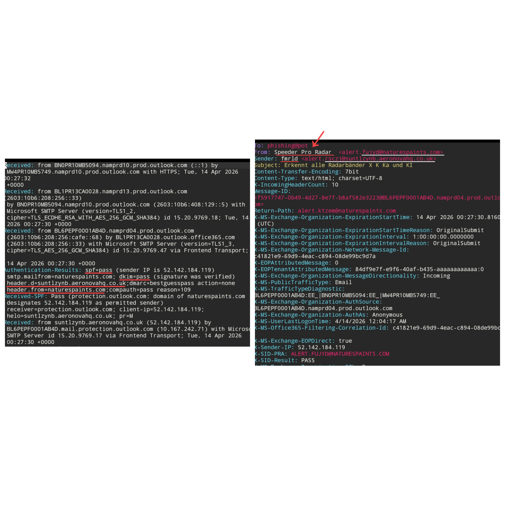
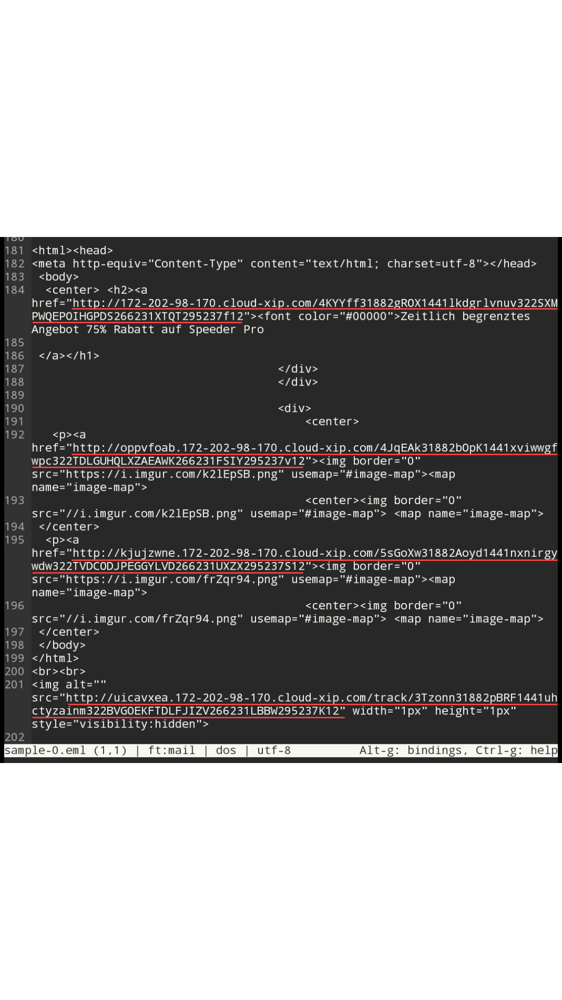

---

EMAIL PHISHING ANALYSIS REPORT (TICKET: INC-2026-000)

Analyst: Andra
Investigation Date: 21 November 2026
Sample File: sample-0.eml
Status: Confirmed Phishing / Malicious

---

**1. Executive Summary**

A suspicious email was identified targeting German-speaking users with a fake promotional offer for a "Speeder Pro Radar" product. Unlike the previous sample (which used low-reputation VPS and Base64), this campaign uses a more sophisticated evasion technique.

The attacker bypassed basic authentication checks by abusing a seemingly legitimate domain (naturespaints.com) and transmitted the payload in plain HTML (7bit). The email utilizes complex HTML obfuscation, including randomized subdomains and hidden tracking pixels, to evade security filters and monitor victim engagement.

---

**2. Header Analysis (Email Metadata)**

· Subject: Erkennt alle Radarbänder X K Ka und KI
· From (Display Name): Speeder Pro Radar <alert.fujyd@naturespaints.com>
· Return-Path: alert.ktzem@naturespaints.com
· Sender IP: 52.142.184.119 (Hosting Provider Infrastructure)
· Authentication Results: spf=pass, dkim=pass, dmarc=bestguesspass

*Key Findings:*

. Domain Reputation Abuse: The attacker did not use a cheap VPS. They sent from naturespaints.com, which likely has an establishe reputation (or was compromised) to successfully pass SPF/DMARC checks and bypass spam filters.

. Authentication Mismatch (Spoofing Indicator): Although the SPF shows pass, there is a glaring mismatch. The header.from is naturespaints.com, but the DKIM signature (header.d) resolves to suntlzynb.aeronovahq.co.uk. This proves the email is being relayed through a different infrastructure than it claims.

---

**3. Email Body Analysis (Body & Payload)**

· Encoding: The email body uses 7bit (plaintext HTML). This means the malicious structure is visible without decoding, likely because the attacker is relying on domain reputation rather than text obfuscation to bypass filters.

· Language & Social Engineering: The payload uses German text ("Zeitlich begrenztes Angebot 75% Rabatt auf Speeder Pro"), translating to "Limited time offer 75% discount on Speeder Pro". This utilizes False Urgency and Greed (Bait) tactics.

*· Evasion Techniques:*

  · Wildcard DNS & Randomized Subdomains: The attacker uses multiple randomized subdomains (e.g., oppvfoab.172-202-98-170.cloud-xip.com, kjujzwne...) pointing to the same IP to bypass URL blocklists. The first link uses the raw IP as a subdomain (172-202-98-170...) as a fallback.

  · Trust Abuse (Imgur): Malicious payload images are hosted on i.imgur.com to bypass image security filters.

*· Tracking & Analytics Mechanism:*

  · Silent Alarm (Tracking Pixel): A hidden 1x1 pixel image () is embedded. It acts as an open-tracker, reporting the victim's IP address, device type, and the exact time the email was opened back to the attacker.

  · A/B Testing: The separate text and image hyperlinks allow the attacker to track which specific element the victim interacted with.

---

**4. Indicators of Compromise (IoCs)**

This is a list of "evidence" that must be blocked by the IT/Network team:

· Malicious URL 1 (Fallback):
*hxxp://172-202-98-170.cloud-xip[.]com/4KYY...*

· Malicious URL 2 (Image 1): *hxxp://oppvfoab.172-202-98-170.cloud-xip[.]com/4JqE...*

· Malicious URL 3 (Image 2): *hxxp://kjujzwne.172-202-98-170.cloud-xip[.]com/5sGo...*

· Tracking URL: *hxxp://uicavxea.172-202-98-170.cloud-xip[.]com/track/...*

· Sender IP: 52.142.184.119

· Attacker Infrastructure IP: 172.202.98.170

· Abused Domains: *naturespaints.com*, *aeronovahq.co.uk*.

---

**5. Recommendations & Mitigation**

. Block URLs & IPs: Add all four randomized URLs, the tracking URL, and the IPs 172.202.98.170 & 52.142.184.119 to the firewall/proxy blocklist.

. Block Sender Domain: Block incoming emails from *naturespaints.com* (unless it is a known legitimate partner) and aeronovahq.co.uk.

. Educate Users: Remind employees to be cautious of emails offering extreme discounts (e.g., 75%) for products they did not search for, especially in foreign languages.

. Investigate Internal Compromise: If any internal user has interacted with this email, check their system for malware, as clicking the link could lead to a credential harvesting page or malware download.

---

**6. Evidence / Appendices**

A. Email Header Analysis (SPF Pass but Domain Mismatch)
Description: Shows SPF pass, but reveals the mismatch between the sender domain (naturespaints.com) and the DKIM domain (aeronovahq.co.uk). Also highlights the Sender: header which exposes the true relay address.

B. Raw HTML Payload (7bit Encoding - Multiple Randomized URLs & Tracking Pixel)
Description: Highlights the German bait text, the three distinct randomized subdomains pointing to the same IP, and the hidden 1x1 tracking pixel at the bottom.

---

 Final Conclusion

This email is confirmed as Phishing with a High severity level. While the previous sample used brute-force VPS tactics, this campaign demonstrates advanced technical evasion. The attacker utilizes domain reputation abuse, wildcard DNS, randomized URLs, and tracking pixels to ensure high deliverability and monitor click-through rates.

---
