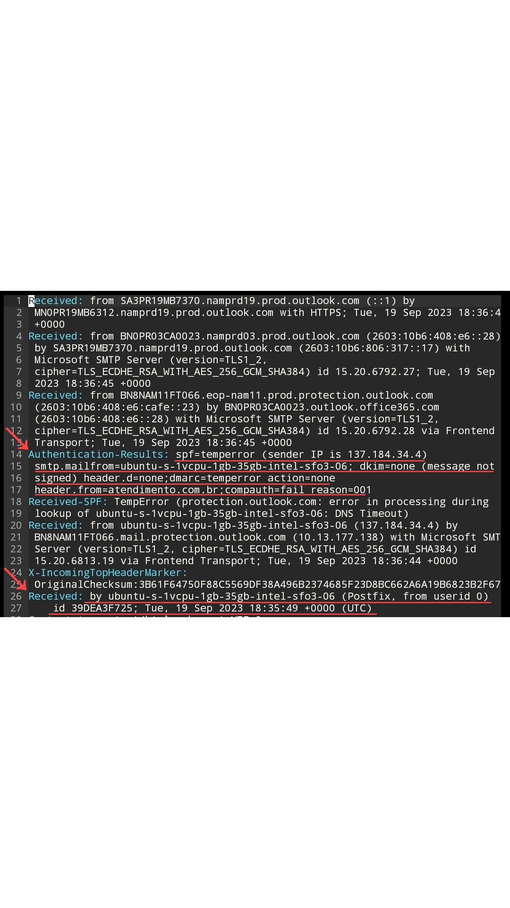
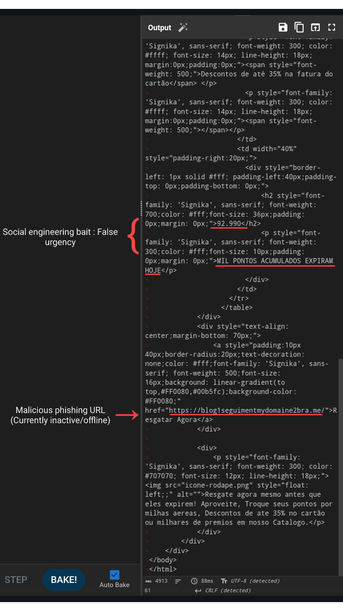

EMAIL PHISHING ANALYSIS REPORT (TICKET: INC-2026-001)

Analyst : Andra
Investigation Date : 20 November 2026
Sample File : sample-1.eml
Status : Confirmed Phishing / Malicious

---

**1. Executive Summary**

A suspicious incoming email was identified employing a phishing scam, impersonating Banco do Bradesco (Livelo), a major bank from Brazil. The email utilizes social engineering tactics to lure the victim into clicking a link that redirects to a fake website.

Analysis of the email header and body confirms that this email was NOT sent from the bank's official server, but rather from a cheap VPS (Virtual Private Server) that has been abused.

---

**2. Header Analysis (Email Metadata)**

· Subject: CLIENTE PRIME - BRADESCO LIVELO: Seu cartão...

· From (Display Name): BANCO DO BRADESCO LIVELO <banco.bradesco@atendimento.com.br>

· Return-Path (Original): root@ubuntu-s-1vcpu-1gb-35gb-intel-sfo3-06...

· Message-ID: <20230919183549.39DEA3F725@ubuntu-s-1vcpu-1gb...>

· Authentication Results: FAIL (SPF: temperror, DMARC: temperror)

Key Findings:

. Spoofing: The attacker forged the sender name (From) to appear as an official bank.

. Attacker Infrastructure: Based on the Return-Path and Message-ID headers, this email was sent from a cheap VPS server named ubuntu-s-1vcpu... (likely rented from a cloud provider such as DigitalOcean).

. Authentication Failure: The receiving system failed to verify the sender server's identity (SPF/DMARC Error), which is a strong indicator that this email is forged.

---

**3. Email Body Analysis (Body & Payload)**

· Obfuscation Technique: The email body is encoded using Base64 to bypass spam filters (Anti-Spam Gateway).

· Social Engineering (Manipulation Tactics):
  · False Urgency: The email claims the victim has 92,990 THOUSAND POINTS that will expire TODAY (EXPIRAM HOJE).
  
  · Bait: Offers discounts up to 35% on credit card bills.
  
  · Call to Action: Provides a "Resgatar Agora" (Redeem Now) button to lure the victim into clicking.

---

**4. Indicators of Compromise (IoCs)**

This is a list of "evidence" that must be blocked by the IT/Network team:

· Malicious URL: hxxps://blog1seguimentmydomaine2bra[.]me/ (Defanged).

· Sender Infrastructure: ubuntu-s-1vcpu-1gb-35gb-intel-sfo3-06 (VPS Server).

· Domain Extension: .me (Frequently used for cheap phishing sites).

---

**5. Recommendations & Mitigation**

. Block URL: Add the domain blog1seguimentmydomaine2bra.me to the company's firewall/proxy blocklist.

. Delete Email: Remove the email from the user's inbox.

. Education: Provide reminders to employees not to panic easily when receiving emails about "expiring points" or "huge discounts".

. Follow-up Check: If the victim has already clicked and entered their data, immediately perform a Password Reset and enable MFA.

---

**6. Evidence / Appendices**

A. Email Header Analysis (Spoofing & Authentication Failure)

*Analysis Notes:*
*   **Authentication Failure (Top Highlight):** The SPF and DMARC results returned `temperror` and `fail`. This indicates the receiving server could not verify if the email was sent from an authorized Bradesco server. It also clearly shows a mismatch between the display name (`atendimento.com.br`) and the actual sending address (`ubuntu-s-1vcpu...`).
  
*   **Suspicious Origin (Bottom Highlight):** This email *should* have originated from the bank's official mail server. However, the header proves it was actually sent from a low-cost Virtual Private Server (VPS) named `ubuntu-s-1vcpu-1gb-35gb-intel-sfo3-06`. A legitimate bank would never use a cheap VPS for official communication.

B. Base64 Decoded Payload (Social Engineering & Malicious URL)

*Analysis Notes:*
*   **Obfuscation Bypass:** The attacker encoded the email body in Base64 to evade standard text-based spam filters.
  
*   **Social Engineering Tactics:** The decoded payload reveals classic manipulation techniques. It creates a false sense of urgency by claiming the victim has `92,990` points expiring *today* ("EXPIRAM HOJE"). It also offers a fake "35% discount" as a reward.
  
*   **Malicious URL:** The "Resgatar Agora" (Redeem Now) button is hardcoded to redirect victims to `blog1seguimentmydomaine2bra[.]me`.
  
*   **Threat Intel Correlation:** The link is currently marked as `(inactive/offline)`. This explains why automated tools like VirusTotal returned 0 detections—the phishing infrastructure has likely been taken down or moved. This highlights the importance of manual header/payload analysis over relying solely on automated scanners.

---

 Final Conclusion

This email is confirmed as Phishing with a High severity level. The email uses basic but effective techniques (urgency and reward bait) to steal the victim's credentials.

---
