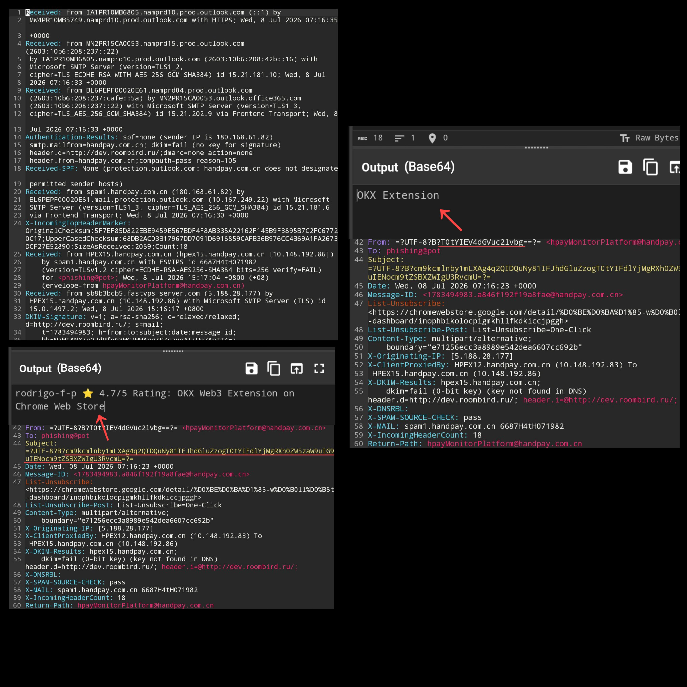
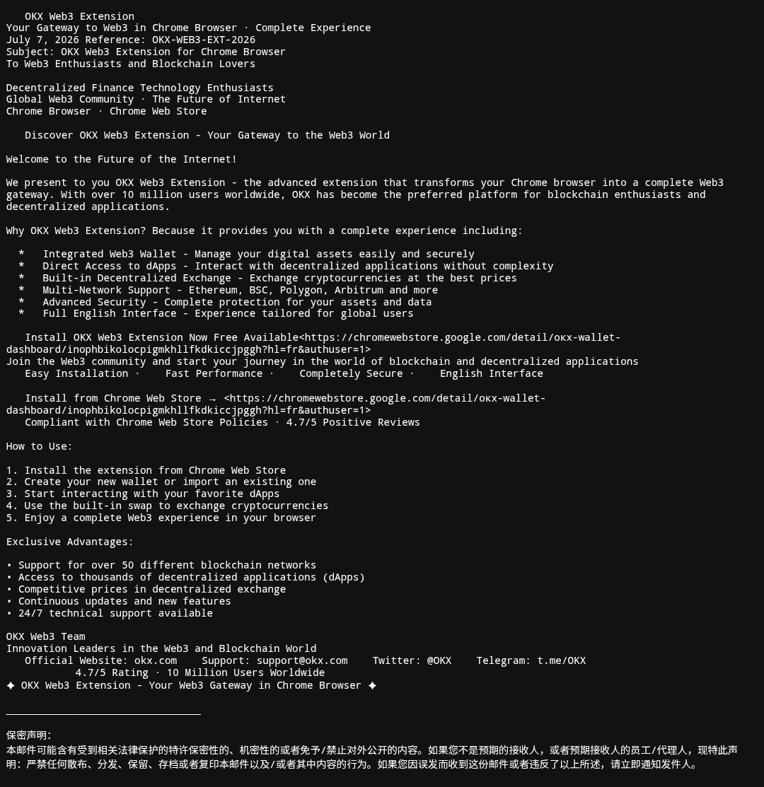

---

EMAIL PHISHING ANALYSIS REPORT TICKET: INC-2026-003

Analyst: Andra
Investigation Date: 23 November 2026
Sample File: sample-2.eml
Status: Confirmed Phishing / Malicious

---

1. Executive Summary

  A suspicious email was identified impersonating OKX, a well-known cryptocurrency exchange platform. Unlike traditional phishing emails that direct victims to fake login pages, this campaign utilizes a Malicious Browser Extension Distribution tactic.

The attacker lures victims with a fake "Web3 Extension" promotion, directing them to a legitimate Google Chrome Web Store link. However, the linked extension is a malicious clone designed to compromise the victim's crypto wallets or browser data.

---

2. Header Analysis (Email Metadata)

· Subject: [Encoded] OKX Web3 Extension - Advanced Chrome Extension for Web3.

· From (Display Name): =?UTF-8?B?T0tYIEV4dGVuc2lvbg==?= (Decodes to "OKX Extension").

· Return-Path: hpayMonitorPlatform@handpay.com.cn.

· Sender IP: 180.168.61.82.

· Authentication Results: spf=none, dkim=fail, dmarc=none.

*Key Findings:*

. Identity Obfuscation: The attacker encoded the Sender Name in Base64 (OKX Extension) to bypass basic text filters.

. Frankenstein Email (Infrastructure Abuse): The email is routed through a Chinese domain (handpay.com.cn) with an invalid DKIM signature (dev.roombird.ru from Russia). The complete lack of SPF/DMARC verification indicates a highly suspicious, unauthenticated sender.

. Header Spoofing (Trust Abuse): The attacker included a List-Unsubscribe header pointing to a legitimate chromewebstore.google.com URL. This is a tactic to abuse Google's high domain reputation and trick email filters (like Microsoft Outlook) into believing this is a legitimate system notification.

---

3. Email Body Analysis (Body & Payload)

  A. Social Engineering Tactics:

  · Authority & FOMO: Uses the famous "OKX" brand and promises exclusive access to "Decentralized Finance Technology" to lure crypto enthusiasts.
  
  · Fake Legitimacy: Claims to have "Over 10 million users" and a "4.7/5 Rating" to build trust.
  
 B. The Payload (Malicious Link):

  · The attacker does not host a phishing page. Instead, they redirect victims to a real Chrome Web Store URL: *hxxps://chromewebstore.google.com/detail/okx-wallet-dashboard/inophbikolocipigmkhlfkdkkiccjgpgh*.
  
  · The extension ID (inophbikolocipigmkhlfkdkkiccjgpgh) is a malicious clone. Once installed, it can steal browser cookies, passwords, or cryptocurrency seed phrases.

---

4. Indicators of Compromise (IoCs)

· Malicious Extension ID: inophbikolocipigmkhlfkdkkiccjgpgh.

· Sender IP: 180.168.61.82.

· Abused Domains: handpay.com.cn, dev.roombird.ru.

· Encoded Sender Identity: T0tYIEV4dGVuc2lvbg== (OKX Extension).

---

5. Recommendations & Mitigation

. Block Domains & IPs: Block emails originating from handpay.com.cn and add the Sender IP to the firewall blocklist.
 
. Report the Extension: If possible, report the malicious Chrome extension ID (inophbikolocipigmkhlfkdkkiccjgpgh) to Google for takedown.
  
. User Education: Educate employees that cybercriminals can abuse legitimate app stores (like Chrome Web Store). Always verify the developer's official website before installing any extension, even if the link comes from Google.
  
. Endpoint Check: Scan the endpoints of any users who might have clicked the link to ensure no malicious extensions were installed.

---

6. Evidence / Appendices

  A. Email Header Analysis (Auth Fail & Header Spoofing)
Description: Shows the complete failure of SPF, DKIM, and DMARC, alongside the Base64 encoded sender name and the deceptive List-Unsubscribe header.

  B. Decoded Email Body (Social Engineering & Malicious Link)
Description: The decoded plaintext reveals the marketing-style bait and the single malicious Chrome Web Store link.

  C. Raw HTML Source Code (Payload Analysis)
Description: The raw HTML payload showing the structure of the fake newsletter and the embedded hyperlink.

---

 Final Conclusion

   This email is confirmed as Phishing with a High severity level. It demonstrates a sophisticated approach by bypassing traditional URL blocklists and abusing Google's platform reputation. Instead of stealing credentials via a fake website, the attacker aims to compromise the victim's browser through a malicious extension.
